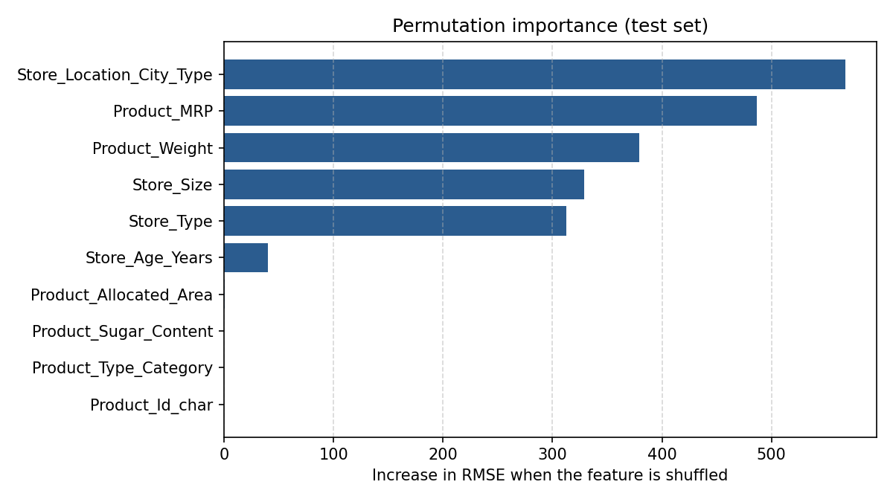
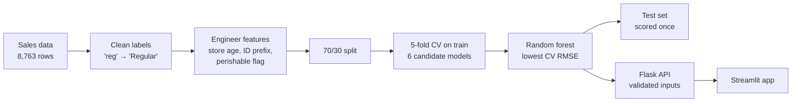

# Retail Sales Prediction

[](https://github.com/Zachsteuer98/retail-sales-prediction-api/actions/workflows/ci.yml)


A model that predicts how much revenue a product will generate in a given store of a
retail chain. It is served through a validated Flask API and a Streamlit app. Merchandising and supply
teams can use it to estimate what a product should sell in each store and to spot products that are
under- or over-performing.

**[Live demo](https://zachsteuer98-retail-sales-app.hf.space)** ·
**[Live API](https://zachsteuer98-retail-sales-api.hf.space/health)** ·
**[Full analysis notebook](notebooks/01_eda_and_model_development.ipynb)**

> Started as a case study in the UT Austin McCombs *AI & Machine Learning for Business Applications*
> certificate. This repo is my own analysis plus a production rebuild (v2).
> The demo runs on free hosting and sleeps when idle; the first request may take about a minute.

---

## Results (held-out test set, 2,629 product-store rows)

| Model | CV RMSE (used to select) | Test RMSE | Test R² | Test MAPE |
|---|---|---|---|---|
| **Random forest (deployed)** | **289.2 ± 19.7** | **278.1** | **0.932** | **4.1%** |
| XGBoost | 290.8 ± 18.5 | 282.4 | 0.930 | 4.4% |
| Gradient boosting | 299.4 ± 17.5 | 287.0 | 0.927 | 4.7% |
| Decision tree | 318.7 ± 19.8 | 295.6 | 0.923 | 5.1% |
| Linear regression (baseline) | 452.9 ± 15.4 | 434.0 | 0.834 | 10.0% |
| Store-average baseline | 603.4 ± 11.3 | 603.5 | 0.679 | 17.1% |

**In plain terms:** predictions are off by about 4% on average. That cuts the error of the simplest
reasonable guess (each store's average) by more than half, and of a linear model by more than half again.

The original notebook's tuned random forest scored R² 0.9319 / RMSE 278.04. The leakage-free v2 pipeline
reproduces it (0.9319 / 278.08), so the original conclusion holds under a stricter method.

## What drives sales



- **Which store it sells in** (location, size and type) and **product price (MRP)** dominate, followed
  by product weight.
- **Sugar content, product category, ID prefix and display area add almost nothing.**
- **The store attributes are one signal, not four.** The data covers only 4 stores, and each store's
  size, city tier, type and age never vary. These columns are effectively a store ID, so their importance
  is shared between them.

## Workflow



### Original analysis ([notebook](notebooks/01_eda_and_model_development.ipynb))
- **EDA:** price (MRP) has a 0.79 correlation with sales; Supermarket Type 1/2 stores outsell Food
  Marts and Departmental Stores; outliers are kept because high-price items carry real signal.
- **Feature engineering:** store age from establishment year, product-ID prefix (FD / DR / NC), and a
  perishable / non-perishable grouping of 16 product types.
- **Models:** random forest and gradient boosting baselines, then GridSearchCV tuning of random forest
  and XGBoost. The tuned random forest was chosen.
- **First deployment:** Flask backend plus Streamlit frontend in separate Docker containers.

### v2: what changed and why

| Issue found in review | Fix |
|---|---|
| Scaler and encoder were fit on all rows before the train/test split (leakage) | Preprocessing lives inside the model pipeline and is fit within each CV fold |
| The champion was chosen by comparing **test-set** scores | Chosen by 5-fold cross-validated RMSE on the training split; test set scored once |
| 108 rows labelled `reg` were treated as a separate sugar category | Normalised to `Regular` |
| No baselines, so the value of the tree models was unclear | Added store-average and linear-regression baselines |
| **The API accepted stores that don't exist.** The brief's batch file describes 10 store configurations the model never saw, including a `Supermarket Type3` category, which the encoder silently ignored | The API validates every row against what training actually covered (the 4 stores, categories and numeric ranges) and returns specific errors. The demo has a button that sends the original file to show this |
| The UI let users combine any size, tier, type and age | Users pick one of the 4 real stores |
| Flask debug server, raw exception text returned to clients | gunicorn, JSON error handlers, internal errors logged, not exposed |

## Architecture

```
Browser ──► Streamlit app (frontend Space) ──HTTP/JSON──► Flask + gunicorn (backend Space) ──► scikit-learn pipeline
                                                              │
                                                              └── /health  /v1/schema  /v1/predict  /v1/predictbatch
```

- **`/v1/schema`** publishes the 4 known stores and accepted values, so clients never hard-code them.
- **`/v1/predict`** takes one JSON object; **`/v1/predictbatch`** takes a CSV (up to 1,000 rows, 5 MB).
  Field names match the original API. Invalid input returns HTTP 422 with every problem listed per row.
- **Tests:** 34 tests cover feature engineering, the schema rules, metrics and every API route (using a
  fake model). CI also checks that the committed model scores the demo sample and rejects the brief's
  invalid batch file.

## Project structure

```
├── notebooks/01_eda_and_model_development.ipynb   # original analysis + first deployment
├── src/retail_sales/      # config, features, models, schema, evaluation, training, inference
├── api/                # Flask backend
├── app/                # Streamlit frontend
├── models/             # trained pipeline + metadata (schema, metrics)
├── reports/            # metrics.json + figures generated by training
├── data/sample/        # demo rows + the brief's original batch file
├── tests/              # pytest suite
├── deploy/             # Dockerfiles for the api and app Spaces
├── docs/decisions.md   # short architecture decision records
└── .github/workflows/  # CI (lint + test + smoke test) and deploy to Hugging Face
```

## Run it locally

```bash
python3.12 -m venv .venv && source .venv/bin/activate
pip install -r requirements-dev.txt

make train    # optional: needs data/raw/SuperKart.csv (see "Data")
make api      # http://localhost:7860/health
make app      # http://localhost:8501 (second terminal)
```

Or run both in Docker: `docker compose up --build`.

```bash
curl -X POST localhost:7860/v1/predictbatch -F file=@data/sample/sample_batch.csv
```

## Test

```bash
make test
make lint
```

## Deploy

Pushing to `main` runs CI. When CI passes, `.github/workflows/deploy.yml` creates or updates two Hugging
Face Docker Spaces and sets the frontend's `API_URL`. The only setup is a repository secret, `HF_TOKEN`
(a Hugging Face write token).

## Data

`SuperKart.csv`: 8,763 product-store rows with product attributes (weight, sugar content, display area,
type, MRP), store attributes (establishment year, size, city tier, type) and the target
`Product_Store_Sales_Total`. The full file is not committed; place it in `data/raw/` to retrain.

## Limitations
- **4 stores only.** The model cannot predict for a new store, and the API refuses to pretend it can.
- **No time dimension.** It predicts product-store sales totals, not a forecast for a future quarter. A
  real forecast needs dated sales history.
- **Store effects are confounded.** Size, tier, type and age can't be separated with 4 stores, so the
  model can't say which of them causes higher sales.
- **Next steps:** dated sales data for true forecasting, more stores, and prediction intervals for
  inventory planning.

---

**Author:** Zach Steuer · [Portfolio](https://zachsteuer98.github.io/AI-Machine-Learning-Portfolio/) · [LinkedIn](https://www.linkedin.com/in/zachary-s-6106a5113/)
